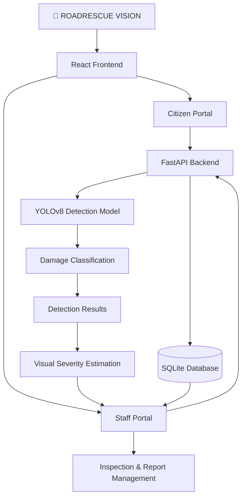
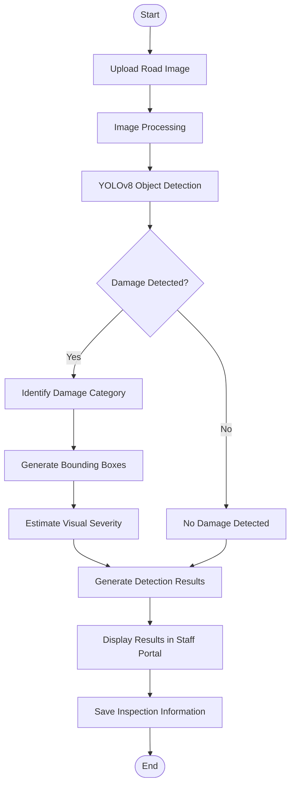
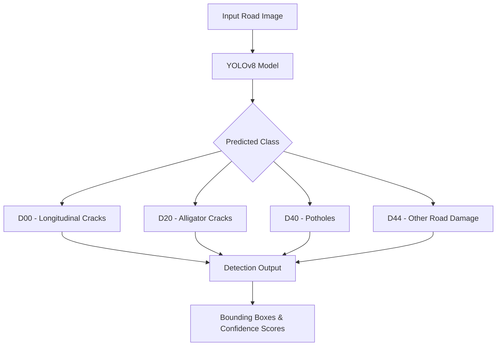
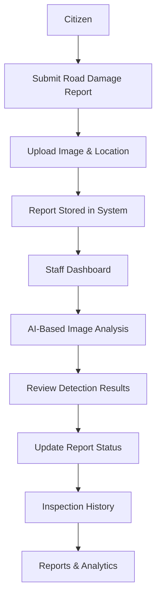
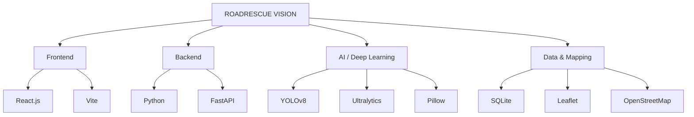

# 🚧 RoadRescue Vision
### AI-Powered Road Damage Detection and Reporting System

<p align="center">

**Detect. Analyze. Report. Improve.**

An AI-powered platform designed to identify road damage, assist inspections, and simplify road maintenance through Deep Learning and Computer Vision.

</p>

---

## 🌍 Overview

RoadRescue Vision is a Deep Learning-based road damage detection and reporting platform that aims to make road inspection smarter and more efficient.

The system uses a **YOLOv8 object detection model** to identify different types of road damage from uploaded images. It combines automated damage detection with a web-based reporting and management platform.

Citizens can report damaged roads by uploading images and sharing location information, while staff can analyze detected defects, review reports, monitor inspection history, and manage road maintenance activities.

The platform brings together Artificial Intelligence, Computer Vision, and web technologies to support more organized road damage monitoring.

---

## 🎯 Problem Statement

Road damage such as potholes and cracks poses serious challenges to road safety, vehicle maintenance, and transportation infrastructure.

Traditional road inspection methods often depend on manual observation and citizen complaints, making identification and reporting time-consuming.

There is a need for an intelligent system that can automatically identify road damage, organize public reports, and assist authorities in reviewing and prioritizing road maintenance.

**RoadRescue Vision addresses this problem through AI-powered road damage detection and a centralized reporting platform.**

---

## 🎯 Project Objectives

- Develop an automated road damage detection system using Deep Learning.
- Identify and classify different categories of road defects.
- Generate visual detection results using bounding boxes.
- Provide preliminary visual severity estimates.
- Enable citizens to report damaged roads with images and location details.
- Provide staff with a centralized dashboard for report management.
- Maintain inspection history and generate downloadable reports.
- Support more efficient road inspection and maintenance planning.

---

## ✨ Key Features

### 👤 Citizen Portal

- Upload road damage images.
- Submit road damage reports.
- Capture GPS-based location information.
- Track submitted report status.
- View reported road damage on an interactive map.

### 🛠️ Staff Portal

- Analyze road images using the YOLOv8 model.
- Automatically detect and classify road defects.
- Display bounding boxes and detection results.
- View preliminary visual severity estimates.
- Review and manage citizen reports.
- Update report statuses.
- Access inspection history.
- Export reports in CSV format.
- View road damage analytics through a dashboard.

---

## 🏗️ System Architecture

RoadRescue Vision follows a client-server architecture integrating the React frontend, FastAPI backend, YOLOv8 detection model, and SQLite database.



---

## 🔄 Road Damage Detection Workflow

The system processes uploaded road images through the trained YOLOv8 model and generates detection results for staff review.



---

## 🧠 Deep Learning Model

RoadRescue Vision uses **YOLOv8 (You Only Look Once)**, a deep learning-based object detection architecture.

The model is trained to identify road damage in images and locate defects using bounding boxes.

### Road Damage Categories

| Class ID | Damage Category | Description |
|---|---|---|
| D00 | Longitudinal Cracks | Cracks extending along the direction of the road |
| D20 | Alligator Cracks | Interconnected cracks forming a pattern similar to alligator skin |
| D40 | Potholes | Depressions or holes in the road surface |
| D44 | Other Road Damage | Other visible road damage categories |

### Classification Workflow



### Visual Severity Estimation

The application generates a preliminary visual severity estimate using detected bounding-box area.

This provides an additional visual indicator to support staff inspection and report review. It is not a certified engineering assessment or a direct measurement of physical road damage.

---

## 👥 Application Workflow

The platform connects citizens and staff through a centralized road damage reporting process.



---

## 🧰 Technology Stack

| Component | Technologies |
|---|---|
| Frontend | React.js, Vite |
| Backend | Python, FastAPI |
| Deep Learning | YOLOv8 |
| Model Framework | Ultralytics |
| Image Processing | Pillow |
| Database | SQLite |
| Interactive Maps | Leaflet, React-Leaflet |
| Map Services | OpenStreetMap |
| API Documentation | Swagger UI |
| PDF Generation | ReportLab |
| Model Training | Google Colab |

### Technology Architecture



---

## 📊 Dataset

The project uses the **RDD-India dataset**, obtained from Roboflow.

The dataset contains annotated road images representing different types of road damage.

### Dataset Details

- Dataset: RDD-India
- Source: Roboflow Universe
- Annotation Format: YOLOv8
- Classes: 4
- Usage: Model training, validation, and testing

**Dataset Source:** [RDD-India – Roboflow Universe](https://universe.roboflow.com/road-damage-detection-b5a1c/rdd-india/dataset/9)

---

## 📂 Project Structure

```text
RoadRescueVision/
│
├── backend/
│   ├── __init__.py
│   ├── main.py
│   └── history.py
│
├── frontend/
│   ├── src/
│   ├── public/
│   ├── package.json
│   └── README.md
│
├── models/
│   └── best.pt
│
├── notebooks/
│
├── experiments/
│
├── data/
│
├── runs/
│
├── .gitignore
├── test_support_db.py
└── README.md
```

**Note:** Dataset files, training outputs, and model checkpoint files are maintained separately and are not included in the Git repository. The `best.pt` file represents the model checkpoint expected by the backend.

---

## 🚀 Future Scope

- Improve road damage detection performance through additional training and dataset improvements.
- Introduce road damage segmentation for more accurate damage-area estimation.
- Support real-time road damage detection from video.
- Develop more advanced visual severity assessment.
- Introduce automated inspection prioritization.
- Explore integration with municipal road maintenance systems.
- Expand the platform to support additional road damage categories.

---

## 🌱 Expected Impact

RoadRescue Vision aims to contribute to:

- Faster identification of visible road defects.
- More organized citizen reporting.
- Improved access to road damage information.
- Better inspection and report management.
- Technology-assisted road maintenance planning.

---

## 👩‍💻 Project Information

| Detail | Description |
|---|---|
| Project Name | RoadRescue Vision |
| Domain | Deep Learning & Computer Vision |
| Application | Road Damage Detection and Reporting |
| Deep Learning Model | YOLOv8 |
| Frontend | React.js |
| Backend | FastAPI |
| Database | SQLite |
| Dataset | RDD-India |

---

<p align="center">

### 🚧 RoadRescue Vision

**Making road damage identification smarter through AI.**

*Detect • Analyze • Report • Improve*

</p>
